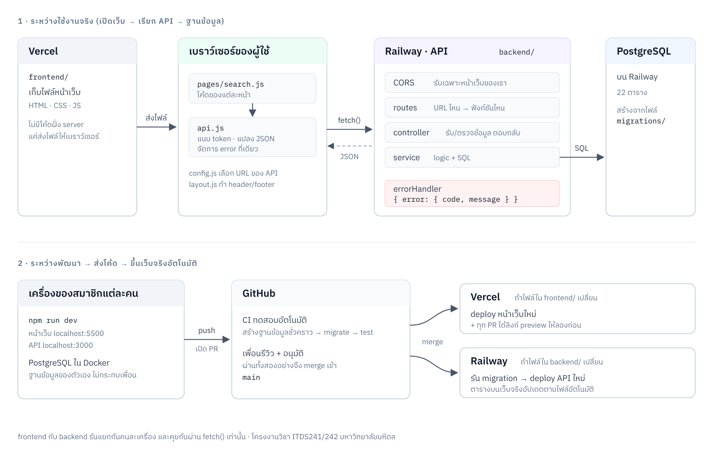

# Maison de Relic — เว็บร้านของสะสม

โครงงานวิชา ITDS241/242 มหาวิทยาลัยมหิดล

| ส่วน | เทคโนโลยี | รันที่ |
|---|---|---|
| หน้าเว็บ | HTML + CSS + Vanilla JavaScript | กล่อง `web` (nginx) ใน Docker · ออนไลน์บน Vercel |
| API | Node.js 24 + Express | กล่อง `api` ใน Docker |
| ฐานข้อมูล | PostgreSQL 16 | กล่อง `db` ใน Docker |

หน้าเว็บกับ API รันแยกกัน และคุยกันผ่าน `fetch()` เท่านั้น ตามข้อกำหนดของวิชา



(ไฟล์ภาพสำหรับใส่รายงาน: `docs/architecture.png` / แก้ไขได้ที่ `docs/architecture.svg`)

**Wireframe (Figma):** [ITDS241 - เว็บขายของสะสม](https://www.figma.com/design/Y7uNT37pCWR2ry4DyerwUO/ITDS241---เว็บขายของสะสม--Wireframe-?node-id=0-1) · รายละเอียด component ดูที่ [`docs/wireframe.md`](docs/wireframe.md)

---

## เริ่มต้นครั้งแรก

> **ยังไม่เคยลงโปรแกรม?** ทำตาม [คู่มือติดตั้งเครื่อง (Windows)](docs/setup.md) ทีละขั้น มีวิธีแก้ปัญหาที่เจอบ่อยและ checklist ให้ติ๊ก

**ต้องติดตั้งก่อน:** [Docker Desktop](https://www.docker.com/products/docker-desktop/), Git และ VS Code
(แนะนำให้ลง [Node.js 24.21.0](https://nodejs.org/en/download) ไว้ด้วย เพื่อให้ VS Code ช่วยเติมโค้ดได้ แต่ตัวระบบรันใน Docker ทั้งหมด)

```bash
git clone https://github.com/PhakawatL/maison-de-relic.git
cd maison-de-relic
docker compose up --build
```

> ต้องเปิดแอป Docker Desktop ไว้ก่อน ครั้งแรกจะใช้เวลาโหลดสักพัก

พอขึ้นข้อความ `API พร้อมใช้งาน` ก็เปิดได้เลย

| เปิดที่ | คืออะไร |
|---|---|
| http://localhost:5500 | หน้าเว็บ (หน้าแรกต้องขึ้นว่า "API เชื่อมต่อแล้ว · ฐานข้อมูล: ok") |
| http://localhost:3000/api/health | API |
| `localhost:5432` user/pass `postgres`/`postgres` | ฐานข้อมูล (เปิดด้วย DBeaver/TablePlus ได้) |

ทุกครั้งที่เปิด ระบบจะสร้าง/อัปเดตตาราง (migration) และใส่ข้อมูลตัวอย่าง (seed) ให้เอง

## ทำงานทุกวัน

```bash
git pull
docker compose up
```

- แก้โค้ด **backend** แล้ว API รีสตาร์ตเอง
- แก้โค้ด **frontend** แล้วกด refresh หน้าเว็บ
- ปิด: กด `Ctrl + C` หรือ `docker compose down`

### คำสั่งอื่น

| คำสั่ง | ใช้ทำอะไร |
|---|---|
| `docker compose up --build --renew-anon-volumes` | หลังมีคนเพิ่ม package ใน `backend/package.json` |
| `docker compose exec api npm run db:migrate` | รัน migration ใหม่โดยไม่ต้องปิดระบบ |
| `docker compose exec api npm run db:reset` | ล้างฐานข้อมูลบนเครื่องแล้วสร้างใหม่ทั้งหมด |
| `docker compose exec api npm test` | รัน test |
| `docker compose logs -f api` | ดู log ของ API |
| `docker compose down -v` | ปิดและลบข้อมูลในฐานข้อมูลทิ้ง |

ถ้าลง Node ไว้ ใช้คำสั่งลัดแทนได้ เช่น `npm run dev`, `npm run db:reset`, `npm test` (ดูใน `package.json`)

### เจอปัญหา

| อาการ | วิธีแก้ |
|---|---|
| `port is already allocated` | มีโปรแกรมอื่นใช้ port อยู่ สร้างไฟล์ `.env` ที่ root แล้วใส่ `DB_PORT=5433` (หรือ `API_PORT` / `WEB_PORT`) |
| `Cannot find module ...` หลัง `git pull` | มีคนเพิ่ม package ให้รัน `docker compose up --build --renew-anon-volumes` |
| แก้ backend แล้วไม่รีสตาร์ต (มักเจอบน Windows) | รัน `docker compose restart api` |
| อยากเริ่มฐานข้อมูลใหม่หมด | `docker compose down -v` แล้ว `docker compose up` |

---

## โครงสร้าง

```
docker-compose.yml        เปิดทั้งระบบ 3 กล่อง: db, api, web
docker/web/nginx.conf     ตั้งค่าเว็บเซิร์ฟเวอร์ของกล่อง web

frontend/                 หน้าเว็บ (กล่อง web / ออนไลน์บน Vercel)
├─ *.html                 หน้าบังคับ 7 หน้า: index, login, search, detail, team, admin/products, admin/users
├─ css/base.css           สไตล์กลาง สี ฟอนต์ ปุ่ม ฟอร์ม
└─ js/
   ├─ config.js           URL ของ API
   ├─ api.js              ตัวเรียก API กลาง (ทุกหน้าต้องเรียกผ่านไฟล์นี้)
   ├─ layout.js           header + footer กลาง
   ├─ utils.js            escapeHtml, formatBaht
   └─ pages/              โค้ดของแต่ละหน้า

backend/                  API (กล่อง api)
├─ Dockerfile             สูตรสร้างกล่อง api (Node 24.21.0)
├─ src/
│  ├─ app.js              ประกอบ middleware + routes
│  ├─ server.js           จุดเริ่มรัน
│  ├─ config/env.js       อ่านค่าจาก .env
│  ├─ db/pool.js          query(), withTransaction()
│  ├─ middleware/         errorHandler (+ auth ของ R2)
│  ├─ utils/AppError.js   ใช้ throw error ตามรูปแบบกลาง
│  └─ modules/            แบ่งโฟลเดอร์ตามเจ้าของงาน (ดู modules/README.md)
├─ db/migrations/         โครงสร้างตาราง (ไฟล์ .sql เรียงเลข)
├─ db/seeds/              ข้อมูลตัวอย่าง
└─ test/

docs/
├─ api.md                 ข้อตกลง API + รายการ endpoint
├─ setup.md               คู่มือติดตั้งเครื่อง (Windows) ทีละขั้น
├─ deploy.md              วิธีตั้งค่า Vercel และ GitHub
├─ wireframe.md           ลิงก์ Figma ไปทุกหน้าจอ แยกตามคนรับผิดชอบ + รายการ component
└─ database/              ER Diagram, Data Dictionary
```

---

## กติกาทีม

1. **ห้าม push เข้า `main` ตรง ๆ** ให้แตก branch แล้วเปิด Pull Request (PR) ทุกครั้ง
   - ข้อยกเว้นเดียว: R1 (Tech Lead) push ตรงได้**เฉพาะงานเอกสาร** (`README.md`, `docs/`)
   - **โค้ดทุกอย่าง** (`frontend/`, `backend/`, `docker-compose.yml`, migration ฯลฯ) ทุกคนรวม R1 ต้องผ่าน PR
2. ตั้งชื่อ branch เป็น `<ประเภท>/<ตำแหน่ง>-<เรื่อง>` เช่น `feat/r1-wishlist`, `fix/r3-stock-count`
3. PR ต้องให้เพื่อนอนุมัติอย่างน้อย 1 คน และ CI ต้องผ่าน (เครื่องหมายถูกสีเขียว)
4. ก่อนเริ่มงานทุกวัน ให้ `git pull` แล้ว `docker compose up` (ระบบ migrate ให้เอง)
5. แก้เฉพาะโฟลเดอร์ของตัวเอง ถ้าต้องแก้ของคนอื่นให้คุยกันก่อน
6. ห้าม commit ไฟล์ `.env` หรือรหัสผ่าน
7. เปลี่ยนโครงสร้างตารางให้เพิ่มไฟล์ migration ใหม่ ห้ามแก้ไฟล์เก่า

```bash
git checkout main && git pull
git checkout -b feat/r1-wishlist
# ... เขียนโค้ด (เปิด docker compose up ทิ้งไว้) ...
git add .
git commit -m "R1: เพิ่ม API wishlist"
git push -u origin feat/r1-wishlist
# แล้วเปิด Pull Request บน GitHub
```

## ใครดูแลอะไร

| ตำแหน่ง | ใคร | GitHub | หน้าที่ |
|---|---|---|---|
| R1 · Tech Lead · After-sales | ภควรรษ (Peem) | @PhakawatL | โครงระบบ, Team page, Wishlist, Review, Refund, Support |
| R2 · Identity · Admin Users | ศุภวิชญ์ (Bonus) | @SuphawitBonus | Login, จัดการผู้ดูแล, สมัครสมาชิก, โปรไฟล์ |
| R3 · Catalog · Inventory | ญาณวุฒิ (Yu) | @yarnawutthongyoung-hue | จัดการสินค้า, สต็อก, สรุปยอดขาย |
| R4 · Discovery · Recommender | ดนยกฤตย์ (Pleng) | @N3ptz | Home, Search, Detail, ระบบแนะนำ |
| R5 · Cart · Checkout · Orders | นรบดี | @tainnnn | ตะกร้า, ชำระเงิน (จำลอง), คำสั่งซื้อ |
